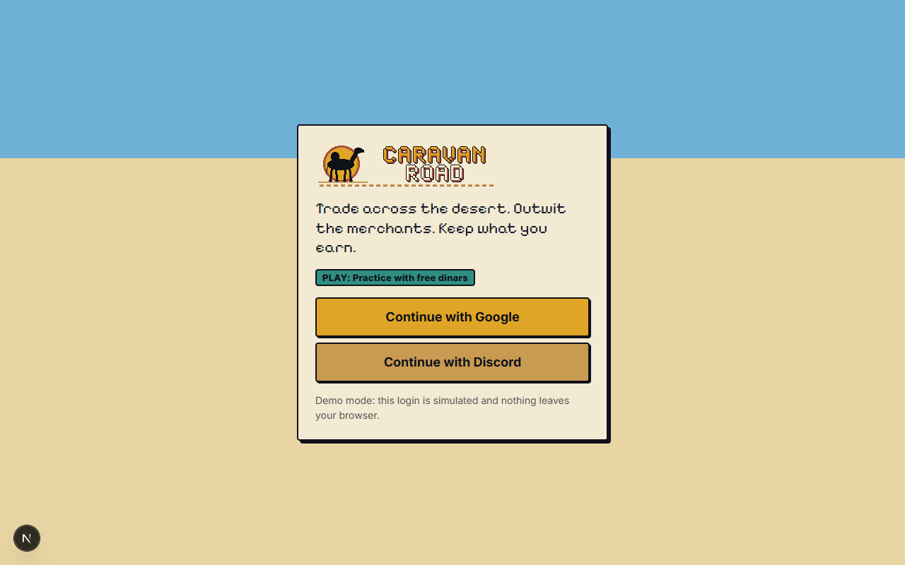
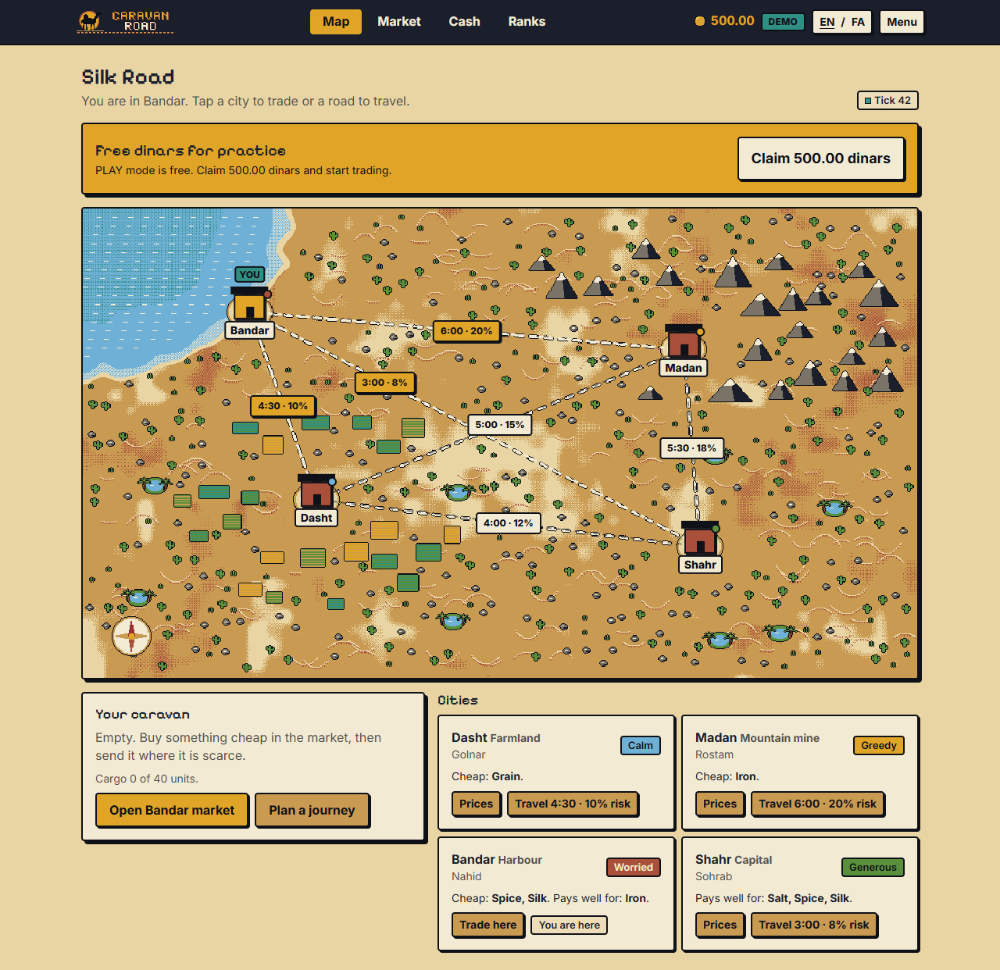
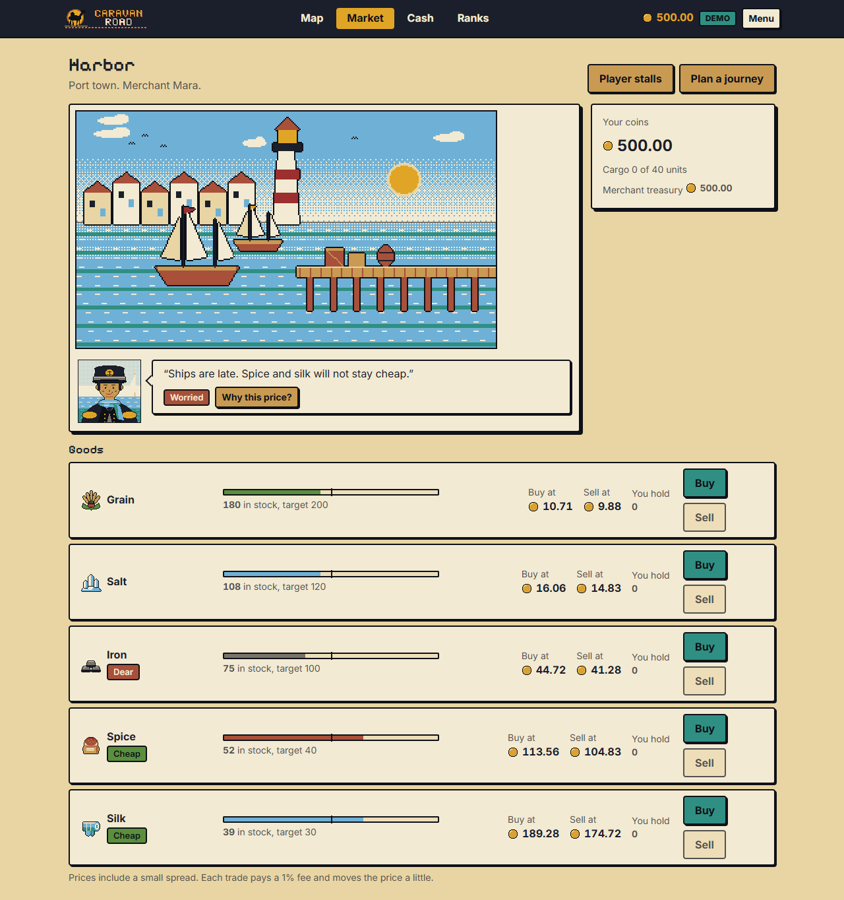

# Caravan Road

A pixel-art trading game on a desert silk road. Buy a good where it is cheap, send a caravan along a risky road with 0 to 3
guards, sell where it is scarce. Four merchants set the prices; the design is that they are AI agents with their own NEAR
accounts and treasuries, and that all rules and money live in one NEAR smart contract, so that players need no wallet or gas.





**Status in one sentence: the game loop runs today in the browser, either on an in-memory mock (no AI, simulated prices) or on a
local backend that uses the real server route handlers with a simulated contract; the NEAR contract, the AI worker and the
NEAR Intents client are implemented and tested offline, and none of them has been deployed or run on a NEAR network or against
NEAR AI Cloud.** See "What is real and what is not".

- Hackathon: NEAR HACKATHON. Intended track: `games`. No other track is claimed: the AI loop has never run live and AI
  attestation is not verified.
- Live demo (PLAY mode): TODO(owner): no deployment exists yet.
- Demo video / X post: TODO(owner). Drafts: [`docs/DEMO_SCRIPT.md`](docs/DEMO_SCRIPT.md), [`docs/X_POST.md`](docs/X_POST.md).
- Team statement and submission text: TODO(owner). Draft and the official-rules comparison: [`docs/SUBMISSION.md`](docs/SUBMISSION.md).
- An independent run-through of this README by a fresh reader, with the problems it found:
  [`docs/JUDGE_REHEARSAL.md`](docs/JUDGE_REHEARSAL.md) (a 2026-11-01 record; see its 2026-11-05/06 update).
- What a judge can check in this repository, with the commands, and what is not verified:
  [`docs/PROOF.md`](docs/PROOF.md). Deployment record (all `TODO(owner)`, nothing is deployed):
  [`docs/deployments.md`](docs/deployments.md).

## Try it in 2 minutes (no wallet, no account, no money, no network services)

Needs Node 20+ (tested with v24.19.0) and pnpm 10 (tested with 10.18.2). The first run needs internet: `next/font` downloads
three UI fonts from Google Fonts (not tested offline).

| # | Do | You should see |
|---|---|---|
| 1 | `pnpm install` | finishes in seconds (a notice about ignored build scripts is harmless) |
| 2 | `pnpm dev:mock` | `Next.js 15.5.28`, `Local: http://localhost:3000`, `Ready` |
| 3 | Open http://localhost:3000. The first visit compiles the page: it can sit on "Loading the caravan" for a few seconds | a login card: "PLAY: Practice with free dinars", "Continue with Google", "Continue with Discord", and "Demo mode: this login is simulated" |
| 4 | Click "Continue with Google", then "Next" twice, then "Claim 500.00 dinars", then "Start trading" | a toast "+500.00 dinars added", 1,000.00 in the top bar, then the "Silk Road" map: "You are in Bandar" |
| 5 | On the Bandar card click "Trade here". Click "Buy" on Spice, press the "−" button until the quantity is **3**, click "Buy for ..." | a toast like "Bought 3 Spice: -346.93 dinars" (114.50 dinars each plus a 1% fee in my run); "Cargo 3 of 40 units" |
| 6 | Click "Plan a journey". Cargo is already the 3 spice. Pick **Shahr** (3:00) and **1 guard** | "Ambush risk 5.2%", "Travel time 3:00", "Guards 1 · 7.20 dinars", and an "est. profit" for Shahr (+11.10 dinars with the guard in my run, +18.30 with no guard; Dasht and Madan showed -1.73 and -22.26) |
| 7 | Click "Send caravan to Shahr" | "On the road", a 3:00 countdown, "Aboard: Spice 3". You have dispatched a caravan; that is the 2 minutes |
| 8 | Optional, 3 minutes later: "Claim your caravan", "Go to the market", "Sell" on Spice | "Safe arrival in Shahr"; a toast like "Sold 3 Spice: +398.58 dinars (+51.65 profit)" (my run, before the 7.20 guard fee). "Ranks" then shows your row among fixture players (rank #2 with 1,051.65 dinars in my no-guard runs, behind Silk Baron 1,824.00 and ahead of Salt Queen 971.50; with the guard the balance was 1,044.45) |

> **Re-observed on 2026-11-05 and 2026-11-06 under spec-v1.2 (`MULT_K_BP` 3000).** The dinar amounts in steps 5-8 come from a headless-Chrome run of exactly these steps against `NEXT_PUBLIC_MOCK=1 next dev` (the server `pnpm dev:mock` starts), run from a clean checkout of commit `72684c2`; the clock of the page was advanced by 400 s for step 8 instead of waiting 3 minutes. Five completed runs (three on a working tree on 2026-11-05, two on the clean checkout on 2026-11-06) gave identical amounts. The mock moves prices on a 5 s tick, so what you see depends on how long the page has been open; expect the same order of magnitude, not the same digits. Under spec-v1.1 (`MULT_K_BP` 4000) the same steps gave -328.96 for the purchase and +71.34 / +77.00 / +103.82 profit in earlier runs. The mock-mode and local-backend screenshots in `docs/screens/` (all but the `stalls-*` ones) were regenerated on 2026-11-06 from the same clean checkout of `72684c2` (which is before the stalls screen of `32141a2`, so the market screens lack its link) with `node apps/web/src/ui/shoot/shoot.mjs http://localhost:PORT docs/screens` and `node apps/web/src/ui/shoot/live.mjs` (their buy and sell amounts are the maximum affordable quantity, not the 3 units of the table: 115.44 dinars each for spice at 5 in the buy sheet, for example).

Also try "Why this price?" on a market: a drawer with the merchant's mood and last decisions. In mock mode this is fixture text
("Fixture decision: ...", tag "Rule-based", "No AI evidence yet"); the fixture for Dasht carries the placeholder model
`fixture-model` and request id `fixture-request-0001` with `attested: false` (`packages/shared/fixtures/decisions.json`).

### The same loop on the local backend (real route handlers, simulated contract)

```bash
node scripts/dev.mjs local        # same on bash, PowerShell and cmd.exe
```

This sets `NEXT_PUBLIC_MOCK=0 SERVER_BACKEND=dev DEV_LOGIN=1 GAME_MODE=PLAY DEV_TICK_SECONDS=5` and runs the web app; the explicit
form and what each switch does are in `docs/SERVER.md` ("Local end-to-end dev mode"). Here the login is a name box and "Play",
and a new player starts with 0 dinars and claims 500 (the contract rule; the mock starts with 500 and lets you claim 500 more).
Wait about a minute after starting before you trade: the world ticks every 5 s (`DEV_TICK_SECONDS=5`; the contract's real
tick is 60 s), and at tick 0 every city has identical prices so every trip loses the spread. Then buy 3 spice in Bandar and pick
the destination whose "est. profit" in the planner is highest. In my run on 2026-11-06 (spec-v1.2, a clean checkout of `72684c2`, about a minute after start, no guard) 3 spice cost 266.57 dinars (the 2026-11-01 run under spec-v1.1 had about 291), the planner showed Dasht (4:30) at +116.18, Madan at +107.27 and Shahr at +21.74, and after the 4:30 trip to Dasht the 3 spice sold for 475.09 (+208.52 profit). The 10% ambush roll fired on that trip; with 3 units nothing is lost, although the result sheet's headline still reads "Ambushed on the road!" (the sheet itself says the cargo was delivered). The sale beat the planner's estimate because prices keep moving while you travel (5 s ticks). Journeys are not sped up: they take their real 3 to 6 minutes
(`DEV_TICK_SECONDS` only affects the market ticks, and the mock has no speed-up either).

### Caveats (read after you have played)

- Prices in the mock are **simulated**: the mock starts from fixture stock levels and moves stock every 5 s
  (`packages/shared/src/mock.ts`); the numbers you see are not market data and will differ from mine. In the local backend the
  prices follow the contract rules with a rule-based stand-in for the merchants (`apps/web/src/server/dev/ticker.ts`).
- Profit is not guaranteed. A merchant can only pay up to its treasury (500 dinars at the start), so a bigger cargo of an
  expensive good can show a loss (5 spice to Shahr did in my runs; known issue, `apps/web/src/ui/SHARED_ISSUES.md` item 4).
  With 3 units an ambush takes nothing (30% of 3 rounds down to 0), so the risk and the guard fee only matter for bigger cargo.
- There is **no AI** in either mode: the mock shows fixtures and the local backend uses a deterministic rule-based stand-in.
  The worker that is meant to call NEAR AI Cloud has only run with a scripted fake model.
- Reloading the page resets the mock world (a journey in progress is lost, and you keep the "claimed" flag). The local backend
  keeps its state in `apps/web/.data/` (git-ignored; delete it for a fresh world).
- If you ran `dev` earlier and then `build` (or the other way round) and the page misbehaves, delete `apps/web/.next` and start
  again.

### Checks without a browser (re-run on 2026-11-05 unless noted)

| Command (from the repository root) | Result seen |
|---|---|
| `pnpm install --frozen-lockfile` | completes in seconds (run 2026-11-01, not repeated) |
| `pnpm typecheck` | `packages/shared`, `apps/web`, `apps/worker`: Done |
| `pnpm test` | all three packages pass (counts in "Economy and tests"); the worker's abort test was flaky once on 2026-11-01 and was fixed in `610eaa6` (the three packages were run separately on 2026-11-05) |
| `pnpm sim` | 5 bots, 240 ticks (spec-v1.2, `MULT_K_BP` 3000): `trips: 190 \| median profit/trip (fils): 1392`, `merchant-broke events: 47`, `money conserved on every tick: yes` (spec-v1.1, K = 4000: 177 / 1088 / 43) |
| `pnpm --filter @caravan/worker dry-run -- --ticks 40 --bots 5 --seed 7` | 160 decisions from a FAKE scripted model (159 "llm"-labelled, 1 keep) against an in-memory world, money conserved on every tick, and a closing "=== FAKE MODEL ===" banner |
| `cd contracts/caravan && cargo test` | `68 passed` (Rust 1.99.1 here; 33 s warm on 2026-11-05; the first, cold build takes minutes) |

### LIVE mode (real money): not tried, cannot be tried yet

The plan has a second mode in which players deposit real assets through NEAR Intents (caps: 20 USDC total deposit per player,
10 USDC per day withdrawal). The deposit and withdraw screens exist (`docs/screens/19-*.png` to `22-*.png`, built against canned
data) and the server flow and 1Click client are tested with a mocked API, but nothing has ever called NEAR Intents or mainnet, and
NEAR Intents has no testnet. `docs/INTENTS.md` lists what the owner must do for a first real test.

## Baseline vs hackathon work

The organisers ask for pre-existing work to be separated from work done during the hackathon. This repository was started before
the build window of 2026-11-01 to 2026-11-14, so it is separated here by a git tag and by dates. History was not rewritten.

- **Baseline** = tag `pre-hackathon-baseline`, commit `260e0a6` (2026-10-31 22:09 +03:30, 18:39 UTC), the last commit before
  2026-11-01. It holds 31 commits, the first dated 2026-10-23 01:16 +03:30 (2026-10-22 21:46 UTC).
- **Hackathon work** = every commit after it. Compare: `https://github.com/<owner>/<repo>/compare/pre-hackathon-baseline...HEAD`:
  TODO(owner): fill in the repository URL once it is public (the repository has no remote yet). Locally:
  `git log pre-hackathon-baseline..HEAD --format='%h %ad %s' --date=iso-strict`.
- The organisers' FAQ (summarised in `docs/SUBMISSION.md`) describes the window as starting at the announcement on 2026-10-19,
  with earlier work counting as baseline. This README uses the stricter cut at 2026-11-01. Whether any of this is acceptable is
  the organisers' decision; the final team statement is TODO(owner).

| Area | At the baseline (`pre-hackathon-baseline`, before 2026-11-01) | Built after it (from 2026-11-01; `git log` dates, commits named) |
|---|---|---|
| Specification (`spec/`), shared package, mock, TypeScript simulation | all of it (`spec-v1`, `spec-v1.1`) | one parameter: `spec-v1.2` (`MULT_K_BP` 4000 to 3000, merged 2026-11-03, `f5dd8e2`, `6222645`, `771d086`): `spec/ECONOMY.md`, `spec/GAME.md`, `spec/CHANGELOG.md`, `packages/shared` constant, golden vectors, sim expectations, regenerated `fixtures/world.json`. Nothing else (`git diff --stat pre-hackathon-baseline HEAD -- spec packages` lists those files only) |
| Smart contract (`contracts/caravan`, 68 tests, audit fixes) | all of it | the same one-parameter change (`005f94e`): the `MULT_K_BP` constant in `math.rs` and the price-dependent test expectations (`math_tests.rs`, `tick_tests.rs`, `trade_tests.rs`); no rule, method or storage change |
| Server (`apps/web/src/server`): routes, custody, relayer, cron, caps, 17 review fixes | all of it | NEAR Intents (1Click) client `c3fb765`; withdrawal follow-up `f98782d`; local end-to-end dev backend and dev login `5b5d134`, `3f0a4a9` |
| AI worker (`apps/worker`): brain, baseline, validation, evaluation harness | all of it | abort-test fix and fake-model labelling `610eaa6` |
| UI (`apps/web/src/app/play`, `components`, `ui`) on the mock | all of it | font digit fix `d5fd7df`, regenerated screens, dev login screen `3f0a4a9`, later UI changes (see `git log`) |
| Art pipeline (`tools/art`) and sprites | all of it (generated 2026-10-30) | nothing |
| Documentation | spec, `docs/SERVER.md`, `WORKER.md`, `NPC_EVAL.md`, `CREDITS.md`, contract README and DECISIONS | this README, `ARCHITECTURE.md`, `ECONOMY.md`, `DEPLOY.md`, `INTENTS.md`, font credits, `DEMO_SCRIPT.md`, `X_POST.md`, `SUBMISSION.md`, `JUDGE_REHEARSAL.md`, helper scripts in `scripts/` |
| Anything running on a NEAR network | nothing | nothing |

Measured on 2026-11-05 at commit `72684c2`: `git log pre-hackathon-baseline..72684c2` lists 27 commits and `git diff --shortstat pre-hackathon-baseline 72684c2` reports 215 changed files (10,314 insertions, 294 deletions), most of them
documentation and screenshots (`git diff --shortstat ... -- apps/web/src/server` alone is 35 files, 3,291 insertions; the `spec packages contracts` change above is 12 files, 221 insertions, 142 deletions). Libraries and
tools are listed in `docs/CREDITS.md` and the `package.json` files. Most code, tests, art and documentation were written by
Claude Code (an AI coding assistant) in sessions directed by the project owner, with separate agent sessions used for reviews;
`PROGRESS.md` records the order of work.

## What it is / the problem

Games with real economies usually put a token first and a game second, and their markets are static or run by a spreadsheet.
Caravan Road tries the opposite: a small, legible trading loop where prices come from stock levels with integer math, and the
other side of every trade is a merchant whose behaviour is chosen by an agent with bounded authority, so that a player can ask
"why this price?" and get a recorded reason. That last part is the design; today the reason text is fixture or rule-based (see
"What is real and what is not").

The loop (`spec/GAME.md`): sign in, get 500 free dinars (PLAY mode), buy a cheap good in a city that produces it, pick a route and
guards, travel 3 to 6 minutes, survive the ambush roll, sell where the good is scarce. Prices move after every trade; merchants
adjust once a minute; a leaderboard ranks net worth. Players need no wallet and pay no gas; the game itself charges a 1% fee on
trades and 2% per guard, in dinars.

## How it works

```
 Browser                      Server (Next.js)                          NEAR
 UI -> api-client --HTTPS-->  /api/* routes
 (MOCK: in-memory world)        Auth.js (Google / Discord)
                                custody: player key encrypted in Postgres
                                relayer: NEP-366 meta-transaction -----> Caravan contract
                                views <--------------------------------  (balances, rules, events)
                                /api/cron/* (tick, health, deposits, withdrawals)
                                       |
                                    Postgres  <---- Worker: 4 merchant agents, one round per minute
                                                      reads views -> NEAR AI Cloud -> validate + clamp
                                                      -> set_policy / ship / world_tick -----> Caravan contract
```

- **Web UI** (`apps/web/src/app/play`, `src/components`, `src/ui`): Next.js 15 / React 19. Talks only to the api-client of
  `packages/shared`; with `NEXT_PUBLIC_MOCK=1` the client serves the simulated world. Chain vocabulary is confined to the
  Advanced drawer and the evidence page (`apps/web/src/ui/vocabulary.test.ts`).
- **Shared package** (`packages/shared`): types, zod schemas, constants, integer price math, fixtures, mock, and the
  TypeScript port of the reference economy simulation.
- **Server** (`apps/web/src/app/api`, `apps/web/src/server`): the 14 routes of `spec/API.md` plus four cron routes; Auth.js
  login; custodial player accounts; relayer; idempotency, rate limits, mode gate. See `docs/SERVER.md`. The local dev backend
  swaps the contract for a strict in-process fake, Postgres for PGlite, and the login for a name box.
- **Contract** (`contracts/caravan`): one `near-sdk` 5.30.0 contract with dinars, goods, merchants, journeys, stalls,
  deposits and withdrawals, so a trade is one atomic transaction. See `contracts/caravan/README.md`.
- **Worker** (`apps/worker`): the NPC loop. The model only sees bounded integers, returns JSON that is validated and
  clamped, and falls back to a deterministic baseline policy. See `spec/NPC.md`, `docs/WORKER.md`.
- **Intents client** (`apps/web/src/server/intents`): LIVE deposits and withdrawals through the 1Click API. See `docs/INTENTS.md`.
- **Art** (`tools/art`): all sprites are generated by code, palette-checked.

Full diagram and the trust and custody model: `docs/ARCHITECTURE.md`.

## NEAR technology used (where in the code)

"Written" means code and tests exist; "run" means it has executed against a real NEAR network. Nothing has run on a real
network yet.

| Tech | Used for | File | State |
|---|---|---|---|
| near-sdk contract (Rust, 5.30.0) | all game rules and money | `contracts/caravan/src/` (`lib.rs`, `game.rs`, `admin.rs`, `math.rs`, `views.rs`) | written; 68 unit/property tests pass; wasm builds (389,493 bytes); not deployed |
| Meta-transactions (NEP-366) | players sign, a relayer pays gas and submits | `apps/web/src/server/contract/near.ts` (`createSignedMetaTransaction`, `relayMetaTransaction`), `apps/web/src/server/near/relayer.ts` | written; tested with fakes; never run on a network |
| Sub-accounts and access keys | one account `p<8hex>.<relayer>` per player; merchants use function-call keys | `apps/web/src/server/near/accounts.ts`; merchant side in `apps/worker/src/chain-near.ts`; setup in `docs/DEPLOY.md` | written; no accounts exist yet, no function-call key has been created |
| Events (NEP-297) | contract events (`trade`, `policy`, `tick`, ...) | `contracts/caravan/src/events.rs` | written, unit tested |
| MT-compatible read-only views (a subset of NEP-245, not full NEP-245; goods cannot be transferred) | `mt_balance_of`, `mt_supply`, ... | `contracts/caravan/src/views.rs` | written, unit tested |
| NEAR AI Cloud (private inference) | merchant decisions | `apps/worker/src/brain.ts`, `models.ts`, `attest.ts` | written from the docs, tested with a mocked HTTP layer; never called the real service |
| NEAR Intents (1Click API) | LIVE deposits and withdrawals | `apps/web/src/server/intents/oneclick.ts` | written from the docs, tested with doc-derived fixtures; never called the real API |
| Social login | Google and Discord sign-in | `apps/web/src/server/auth/config.ts` (Auth.js v5) | written; not run with real OAuth apps |

## What is real and what is not

| Thing | Status |
|---|---|
| The UI | Real code that runs today in two ways: on the in-memory mock (fake login, fixture merchants, fixture leaderboard, 5 s tick) and on the local dev backend (`node scripts/dev.mjs local`): the full loop was run end to end in a browser against the **real route handlers** with a **fake contract** and an in-process Postgres (PGlite): name login, faucet, buy, journey with a guard, claim, sell. That is not a chain: no NEAR network, no real OAuth, no real database server. Screenshots of every screen at phone and desktop widths are in `docs/screens/` |
| Smart contract | Implemented and tested offline (68 tests). **Not deployed** to testnet or mainnet. No `near-workspaces` sandbox test exists, so the `#[private]` check on `init`, function-call key restrictions, real gas and real storage costs are untested. `grant_discount` (haggling) is not implemented. Built with plain `cargo`, not `cargo-near`, which was not available on the build machine |
| Server | Implemented and tested offline (route handlers, custody, relayer, cron, caps) against a fake contract and PGlite, and exercised through the UI on the local dev backend. **No real database, no OAuth app, no deployed contract, no host.** The testnet smoke script exists and has not been run |
| AI merchants | The worker is implemented and tested with a mocked NEAR AI client and a scripted FAKE model. **It has never called NEAR AI Cloud, never run against a deployed contract, never been deployed.** In the UI the merchants are fixtures (mock) or a rule-based stand-in (local backend). The numbers in `docs/NPC_EVAL.md` are for the fake model, not a language model; the real-model replay was not run |
| TEE attestation | The worker records the request id, the model id, hashes of the request and response and, when offered, the response signature. **It never verifies the TEE quote**: the verifier is not implemented, so `attested` is `false` in every decision the worker writes, and the UI never shows a verified mark. "Private AI (TEE)" with "evidence recorded" is the most this project claims |
| Testnet (PLAY) and mainnet (LIVE) | Neither has been used. PLAY (testnet, free dinars) is the judges' mode in the plan; LIVE (mainnet, real deposits) is the first thing to cut if time runs out |
| NEAR Intents / 1Click | Client and server flow written and tested offline. It never touched the real API; the auth header, the USDC asset id and whether the withdrawal deposit address accepts USDC are open until a first tiny live test (`apps/web/src/server/intents/OPEN_ISSUES.md`) |
| Art | Every sprite is generated by code in `tools/art` (Python + Pillow) from a 12-colour palette, not drawn by hand or by an image model; generated on 2026-10-30 (`docs/CREDITS.md`) |
| Simulation figures | Printed by the reference simulation (`pnpm sim`, port of the master plan's Appendix B) and by tests, not by live play. Greedy bots, a sanity check, not a forecast (`docs/ECONOMY.md`). Economy tuning with live play has not happened |
| Custody | Players do not hold keys: the server generates, encrypts (AES-256-GCM) and holds every player's key, so the accounts are custodial. The relayer key is a full-access key. See "Security notes" |
| Audit | No professional audit. The contract and the server each had an independent review pass by a separate agent session, with all findings fixed or documented (`contracts/caravan/DECISIONS.md`, `docs/SERVER.md`) |
| Integration on a network, demo video, X post, submission | Not done |

### Cut list status (master plan 0.3 rule 14)

| Item | Status |
|---|---|
| 1. Haggling | Cut: not implemented (no `grant_discount`, no player text ever reaches the model) |
| 2. Player stalls | Contract and server API implemented and tested; a UI screen at `/play/city/<id>/stalls` was added in `32141a2` (helper and mock-flow tests; walkthrough screenshots `docs/screens/stalls-*`), never run on a network |
| 3. LIVE withdrawals | Server flow, 1Click client and the cron follow-up of sent withdrawals (mark done, or refund on chain) written and tested offline; never run |
| 4. Mainnet | Not deployed |

Items the plan says must never be cut: trading, journeys, AI merchants on NEAR AI Cloud, meta-transactions, PLAY mode, README,
demo. Status: trading, journeys and PLAY mode run on the mock and on the local backend only; the AI merchants and
meta-transactions are written and tested offline but have never run live; this README exists; the demo has not been recorded.

### Known limitations

- The relayer key is a full-access key on the parent account of all player accounts (`docs/SERVER.md`, finding 8).
- Player accounts are custodial; there is no key export or passkey.
- `cargo-near` was not used (it needs NASM on Windows); `contracts/caravan/.cargo/config.toml` passes cargo-near's wasm flags
  to plain `cargo`.
- Ambush randomness uses `env::random_seed()`, which block producers can influence.
- The contract has no events view: `/api/state` can only show events from transactions this server instance submitted.
- The `/api/proof/{merchant}` response shape was never specified; `spec/OPEN_QUESTIONS.md` items 1, 2, 3, 7, 9, 10 and 13 are
  provisional behaviours.
- Cron routes need an external scheduler; none is configured.
- A new player's first `/api/state` call blocks while the server creates the account (expected to take a few seconds on a
  real network; never measured against a network).
- Licensing: a root `LICENSE` (MIT, "Caravan Road contributors") was added in `ff17cc3`; the owner should confirm the license text and the copyright holder before the repository goes public (TODO(owner)).

## Run it locally

```bash
pnpm install
pnpm dev:mock                          # mock mode (see "Try it in 2 minutes")
node scripts/dev.mjs local             # local backend: real route handlers, simulated contract
# tests, types, lint, build:
pnpm test && pnpm typecheck
pnpm --filter @caravan/web lint
pnpm --filter @caravan/web build        # delete apps/web/.next first if you ran `dev` before
pnpm --filter @caravan/worker lint
# worker dry run (fake model, no network):
pnpm --filter @caravan/worker dry-run -- --ticks 40 --bots 5 --seed 7
# economy simulation:
pnpm sim --bots 5 --ticks 240 --seed 7
# contract:
cd contracts/caravan && cargo test
cd contracts/caravan && cargo build --target wasm32-unknown-unknown --release   # needs: rustup target add wasm32-unknown-unknown
# art (needs Python 3 with Pillow and pytest):
cd tools/art && python -m pytest -q
```

Environment variable **names** (values go in `apps/web/.env.local` or the host dashboard, never in the repository; the
template is `.env.example`). The real server needs a deployed contract, Postgres and OAuth apps, so there is no "real mode
in 2 minutes"; the two local modes above need no variables at all.

| Component | Names |
|---|---|
| UI | `NEXT_PUBLIC_MOCK` (set to `1` for the mock; must be unset on a real deployment), `NEXT_PUBLIC_MODE` |
| Local backend only (refused in production) | `SERVER_BACKEND`, `DEV_LOGIN`, `DEV_TICK_SECONDS` (set by `scripts/dev.mjs local`) |
| Server, always | `GAME_MODE`, `NEAR_NETWORK`, `CARAVAN_CONTRACT_ID`, `RELAYER_ACCOUNT_ID`, `RELAYER_PRIVATE_KEY`, `OPERATOR_ACCOUNT_ID`, `OPERATOR_PRIVATE_KEY`, `KEY_ENC_SECRET`, `DATABASE_URL`, `AUTH_SECRET`, `CRON_SECRET` |
| Server, sign-in | `AUTH_GOOGLE_ID`, `AUTH_GOOGLE_SECRET`, `AUTH_DISCORD_ID`, `AUTH_DISCORD_SECRET` |
| Server, LIVE only | `NEAR_RPC_URL`, `TREASURY_ACCOUNT_ID`, `TREASURY_PRIVATE_KEY`, `ONECLICK_JWT`, `ONECLICK_USDC_ASSET_ID` |
| Worker | `NEAR_NETWORK`, `NEAR_RPC_URL`, `CARAVAN_CONTRACT_ID`, `MERCHANT_ACCOUNT_DASHT`, `MERCHANT_ACCOUNT_MADAN`, `MERCHANT_ACCOUNT_BANDAR`, `MERCHANT_ACCOUNT_SHAHR`, `KEY_DASHT`, `KEY_MADAN`, `KEY_BANDAR`, `KEY_SHAHR`, `DATABASE_URL`, `NEAR_AI_API_KEY`, `NEAR_AI_MODEL`; optional `NEAR_AI_BASE_URL`, `NEAR_AI_RESPONSE_FORMAT`, `WORKER_PERIOD_SECONDS`, `WORKER_STAGGER_SECONDS`, `WORKER_ID` |

`node scripts/check-env.mjs --target web|worker|all` prints which names are missing without printing values.
Deploying: `docs/DEPLOY.md`.

## Economy and tests

- Formulas, parameters, golden vectors, and which numbers come from the reference simulation versus the contract:
  `docs/ECONOMY.md`. NPC evaluation (fake model): `docs/NPC_EVAL.md`.
- `pnpm sim` (greedy bots, 240 ticks, seed 7; the Appendix B reference rules, which differ from the contract in three rules).
  The current spec is **spec-v1.2 (`MULT_K_BP` 3000)**, merged 2026-11-03; spec-v1.1 had 4000), so the Appendix B figures changed;
  `scripts/ref/economy_sim.py` (K = 3000 since `083bc34`) and `pnpm sim` agree. The spec-v1.1 figures were 64 / 5,944 / 23, 177 / 1,088 / 43, 342 / 1,099 / 86; table below re-run on 2026-11-05:

  | Bots | Trips | Median profit per trip (fils) | "Merchant broke" events | Money conserved |
  |---|---|---|---|---|
  | 2 | 53 | 5,795 | 10 | yes |
  | 5 | 190 | 1,392 | 47 | yes |
  | 10 | 329 | 689 | 72 | yes |

  The same simulation with the contract's rules (`scripts/analysis/econ_variant.py`, `contract_d123(mult_k=3000)`; no `pnpm`
  command prints it): 53 / 8,175 / 16, 182 / 739 / 28, 314 / 704 / 66. At K = 4000 (spec-v1.1, recorded in
  `contracts/caravan/DECISIONS.md` and `spec/CHANGELOG.md`): 61 / 6,714 / 26, 132 / 933 / 44, 344 / 958 / 74.
- Test counts: run on 2026-11-05/06 (the web count changes as tests are added; the web figure is from a clean checkout of `32141a2`, which includes the stalls screen's tests; the others were unaffected by that commit):

  | Package | Command | Result |
  |---|---|---|
  | `packages/shared` | `pnpm --filter @caravan/shared test` | 35 passed (4 files) |
  | `apps/web` | `pnpm --filter @caravan/web test` | 332 passed (17 files) |
  | `apps/worker` | `pnpm --filter @caravan/worker test` | 180 passed (10 files) |
  | `contracts/caravan` | `cargo test` | 68 passed |
  | `tools/art` | `python -m pytest -q` | 25 passed |

  Typecheck passes for all three TypeScript packages, `pnpm --filter @caravan/web lint` and `pnpm --filter @caravan/worker lint`
  pass, and on the contract `cargo clippy --all-targets` and `cargo fmt --check` are clean (all run 2026-11-05); the wasm build
  (`cargo build --target wasm32-unknown-unknown --release`) is 389,493 bytes. If a second folder with the same package name `@caravan/web` exists in `apps/`, the filter
  runs both; use `--filter ./apps/web`.

## Security notes

- **Custody.** The server holds every player's ed25519 key, encrypted with AES-256-GCM under `KEY_ENC_SECRET`; whoever has that
  secret and the database can act as any player. The relayer account's full-access key creates accounts and pays gas.
  The owner's full-access key is meant to stay on the owner's own machine. Merchants are meant to hold only function-call
  keys limited to `set_policy`, `ship` and `world_tick`; none exists yet. The operator key is limited by a daily cap inside
  the contract. Details: `docs/ARCHITECTURE.md`.
- **Keys and secrets.** Variables only; `.env*` is git-ignored except `.env.example`; the server's env loader and the worker
  report only variable names; logs redact keys, bearer tokens, e-mails and account ids. `bash scripts/secret-scan.sh` scans
  the tree (and, with `--history`, all commits); on 2026-11-01 the working tree was clean, and `--history` reported one
  key-shaped test constant in two old commits of `apps/web/src/server/__tests__/foundations.test.ts` that the owner has
  to confirm is not a real key.
- **Limits for real money (implemented, tested offline, never exercised live).** 20 USDC total deposit per player, 10 USDC
  per day withdrawal, minimum withdrawal 1,000 fils and one open withdrawal per player, an operator daily deposit cap, merchant
  treasuries of 5 USDC each (the maximum operator loss in the model: 20 USDC), PLAY mode closes every money route, a database
  `PAUSE_ALL` flag and a contract `paused` flag (the owner alone can unpause).
- **Local dev backend.** Its login route answers 404 unless `NODE_ENV` is not production, `DEV_LOGIN=1`, `GAME_MODE=PLAY` and the
  host is localhost; the server code throws at startup if the dev switches are set in production (`docs/SERVER.md`).
- **AI authority.** The model proposes JSON from bounded integers only; the worker validates and clamps; the merchant key can
  call only a few methods; the contract re-checks ranges, step sizes (300 bp per change, once per tick) and shipping limits.
  Worst case after a compromised model: a bad price inside the allowed range (`spec/NPC.md`).
- **Review results.** Contract: 12 findings, all fixed with tests (`contracts/caravan/DECISIONS.md`). Server: 17 findings, fixed
  or documented, each with a test (`docs/SERVER.md`). These were review passes by separate agent sessions, not a professional audit.

## License / credits

- `LICENSE` at the repository root: MIT, added in `ff17cc3` (the contract crate declares `license = "MIT"` in
  `contracts/caravan/Cargo.toml`). TODO(owner): confirm the license and the copyright line before publishing.
- Credits and provenance (generated art, the three OFL-licensed UI fonts Pixelify Sans, Inter and Vazirmatn, build-time
  libraries): `docs/CREDITS.md`.
- Documents: `spec/` (the locked specification, tags `spec-v1`, `spec-v1.1`, `spec-v1.2`), `docs/PROOF.md` (what a judge can verify and how),
  `docs/deployments.md` (empty record of deployments), `docs/ECONOMY_TUNING.md`, `docs/ARCHITECTURE.md`, `docs/ECONOMY.md`,
  `docs/SERVER.md`, `docs/WORKER.md`, `docs/NPC_EVAL.md`, `docs/INTENTS.md`, `docs/DEPLOY.md`, `docs/DEMO_SCRIPT.md`,
  `docs/X_POST.md`, `docs/SUBMISSION.md`, `docs/JUDGE_REHEARSAL.md`, `PROGRESS.md`.
