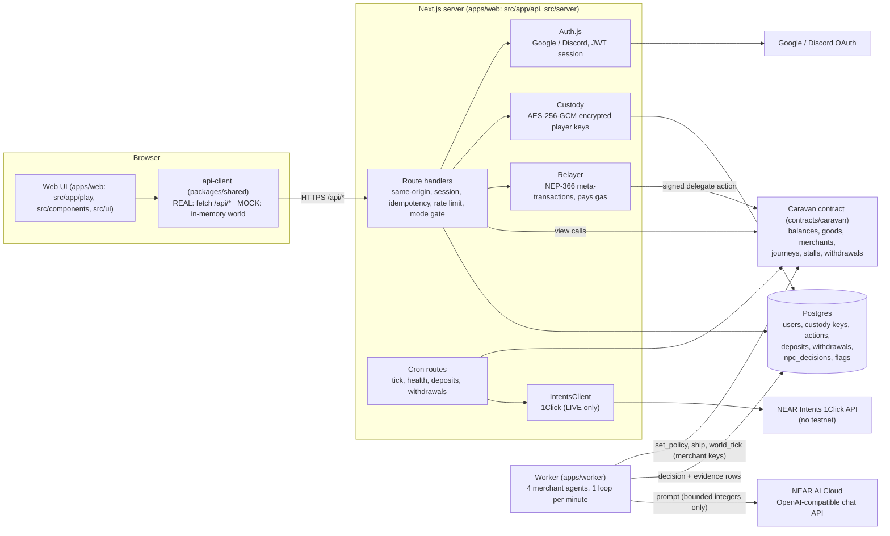

# Architecture

Caravan Road has five runtime parts: a browser UI, a Next.js server, one NEAR smart contract, a worker that
runs four AI merchants, and external services (Postgres, Google/Discord login, NEAR AI Cloud, NEAR Intents).

> Status of each part today (2026-11-01): the UI runs on an in-memory mock; the server, worker and contract
> are implemented and tested offline (fake contract, in-memory or PGlite database, mocked HTTP). Nothing is
> deployed. See the README section "What is real and what is not".

## Diagram



The same picture in plain text:

```
 Browser                     Server (Next.js)                        NEAR
 -------                     ----------------                        ----
 UI --> api-client --HTTPS--> /api/* routes
        (MOCK: in-memory)       |  Auth.js (Google / Discord) --> session
                                |  custody: player key, encrypted in Postgres
                                |  relayer: wraps the player's signed delegate action,
                                |           pays gas -------------------------------> Caravan contract
                                |  views (get_world, get_player, ...) <------------- (state, rules, events)
                                |  /api/cron/* (Bearer CRON_SECRET)
                                |     tick: world_tick() if the worker heartbeat is stale  -->
                                |     deposits/withdrawals: 1Click API <--> treasury account
                                v
                              Postgres  <--------------- Worker (4 merchants, 1 round per minute)
                                                           reads views, asks NEAR AI Cloud,
                                                           validates + clamps, then calls
                                                           set_policy / ship / world_tick -----> Caravan contract
```

## Components

**Web UI (`apps/web/src/app/play`, `src/components`, `src/ui`).** A Next.js 15 / React 19 client with a
pixel-art desert theme: login, a three-step onboarding, the map, a market per city with buy/sell sheets, a
journey planner and tracker, the "Merchant mind" drawer showing each merchant's last decisions, a cash screen
(LIVE deposit/withdraw), a leaderboard, an Advanced drawer and an AI-evidence page. It talks only to the
api-client; it never calls `/api` with `fetch` itself. Blockchain vocabulary is confined to the Advanced drawer
and the evidence page, enforced by `apps/web/src/ui/vocabulary.test.ts`. With `NEXT_PUBLIC_MOCK=1` the whole UI runs against
the in-memory mock and a fake login.

**api-client and shared package (`packages/shared`).** The single definition of types, zod schemas, world
constants, integer price math (`quote()`, `tradeCost()`), fixtures, the mock world, and the TypeScript port of the
reference economy simulation (`pnpm sim`). Both the UI and the server import it, so a price shown in the browser
and a price charged by the contract come from the same formulas; the Rust contract re-implements them and both are
tested against the same golden vectors (`docs/ECONOMY.md`).

**Server (`apps/web/src/app/api`, `apps/web/src/server`).** Next.js route handlers that implement the 14 API
routes of spec 2.13 plus four cron routes. Every POST goes through the same pipeline: same-origin check, session,
`Idempotency-Key`, zod validation, `PAUSE_ALL`, mode gate (PLAY closes all money routes), 30 actions per minute per
user, idempotent replay, then the relayer call and the mapping of contract panics to the `ErrorCode` set. Detail
and the 17 findings of the security review are in `docs/SERVER.md`. The database schema is
`apps/web/src/server/db/migrations/`.

**Accounts and custody (`src/server/near`).** At first login the server generates an ed25519 key pair, creates the
NEAR sub-account `p<8hex>.<RELAYER_ACCOUNT_ID>`, calls `register()`, and stores the private key AES-256-GCM
encrypted with `KEY_ENC_SECRET`. The player never sees an account, a key or a fee. Every action is signed as a
NEP-366 delegate action with the player's key (decrypted in memory only), then wrapped and paid for by the relayer
account. Consequence: these accounts are **custodial**; whoever holds `KEY_ENC_SECRET` and the database can act as
any player.

**Contract (`contracts/caravan`).** One Rust `near-sdk` 5.30.0 contract holds dinars, goods, the four merchants,
journeys, player stalls, deposits and withdrawals, so every trade (give goods, take money) is one atomic
transaction. All money is integer fils with checked arithmetic. It enforces every rule: prices, fees, ambush rolls,
caps, pause, access control per caller (owner, operator, merchant, player). It emits NEP-297 events and exposes
read-only MT-compatible views (a subset of NEP-245; goods cannot be transferred). Details: `contracts/caravan/README.md`
and `DECISIONS.md`.

**Worker (`apps/worker`).** Once a minute, per merchant (staggered), it reads the world from the contract, computes
bounded integer features and a rule-based list of shipping options, asks NEAR AI Cloud for one JSON decision
(spread, bias, mood, a line in English and Persian, a reason, an optional shipping choice), validates and clamps it
with zod, and applies it with the merchant's own key: `set_policy` and `ship`, plus `world_tick` once per round. If
the model fails it falls back to a deterministic baseline policy. Every decision is stored with its reason, model and
request id. The model sees only integers and ids, never player text. Details: `spec/NPC.md`, `docs/WORKER.md`.

**Cron routes (`/api/cron/*`).** `tick` calls `world_tick()` when the worker's heartbeat is stale; `health` reports
balances and the heartbeat; `deposits` and `withdrawals` drive the LIVE money flow. All require
`Authorization: Bearer $CRON_SECRET` and need an external scheduler (none is configured in this repository).

**NEAR Intents client (`apps/web/src/server/intents`).** For LIVE mode only. A deposit asks the 1Click API for a quote
(USDC on NEAR to the treasury account), shows the deposit address, and the cron credits the player once the status is
`SUCCESS`. A withdrawal debits the player on chain, asks for a quote from USDC to the chosen asset, and transfers USDC
from the treasury to the quote's deposit address. It fails closed unless `GAME_MODE=LIVE`, mainnet and all its
variables are set. See `docs/INTENTS.md`.

**Art (`tools/art`, `apps/web/public/assets`).** Every sprite is generated by Python code and checked against the
12-colour palette; see `docs/CREDITS.md`.

## Trust and custody model

Who can do what, and with which key (planned deployment; none of it exists on a live network yet):

| Actor | Key | Can do | Cannot do |
|---|---|---|---|
| Player | per-player ed25519 key, held **by the server**, encrypted in Postgres | the player methods of the contract, through the relayer, with zero deposit | anything outside their own account |
| Relayer account | a **full-access** key (known limitation) | pays gas; is the parent that creates player accounts | change game rules; hold game money (balances live in the contract) |
| Operator (server) | key in the host environment | `credit_deposit`, `mark_withdraw`, `refund_withdraw`, pause | unpause (owner only); credit above the daily cap or the same reference twice |
| Treasury (server, LIVE only) | hot key in the host environment | receive deposits, pay withdrawals | hold more than the few USDC the owner puts there |
| Merchant | function-call key on its own account, planned limits: `set_policy`, `ship` and `world_tick` on this contract | set a spread and bias inside the allowed range and step size; ship goods the code proposed | move treasury money outside those methods; take a full-access action |
| Owner | full-access key on the owner's own machine, never on a server | set the operator, raise the player cap, unpause | n/a |
| AI model | none | return JSON that the worker validates and clamps | send transactions, see player text, move treasury |

Layers around the AI (`spec/NPC.md` section 2): the model only proposes JSON; the worker validates and clamps it;
the merchant key can call only a few methods; the contract re-checks every range, step and limit. Worst case after a
compromised model: a bad price inside the allowed range.

What is **not** trustless:

- The server holds every player's key. It could spend a player's in-game balance. There is no key export and no
  passkey yet (`docs/SERVER.md`, custody note).
- The relayer key is a full-access key on the account that parents all player accounts (`docs/SERVER.md`, finding 8).
  Its blast radius is the relayer's own balance and control of the player sub-accounts, which hold almost nothing.
- Ambush rolls use `env::random_seed()`, which block producers can influence. Fine for a demo, not for stakes.
- AI evidence is recorded, not verified: the worker stores the request id, the model id, hashes and the response
  signature when the service provides one, but the TEE quote verifier is not implemented, so `attested` is `false` in
  every decision the worker writes and the UI never shows a verified mark (`docs/WORKER.md`).
- The treasury is a hot wallet. In LIVE the operator's maximum loss is bounded by design: merchant treasuries
  (4 x 5 USDC), the per-player deposit cap (20 USDC), the daily withdrawal cap (10 USDC), `PAUSE_ALL` in the database
  and the contract's `paused` flag.
- The contract and server have been reviewed by independent AI-assisted audits (12 and 17 findings, all fixed or
  documented) but have **not** had a professional security audit.

## Where state lives

| State | Where |
|---|---|
| Balances, inventory, journeys, stalls, merchant stock, treasuries, withdrawals | contract |
| Merchant mood, last line, evidence, decision history | Postgres (`npc_decisions`, `npc_evidence`), written by the worker |
| Users, encrypted player keys, action log, idempotency, rate limits, deposits and withdrawals bookkeeping, flags | Postgres |
| Mock world | browser memory only (lost on reload) |
